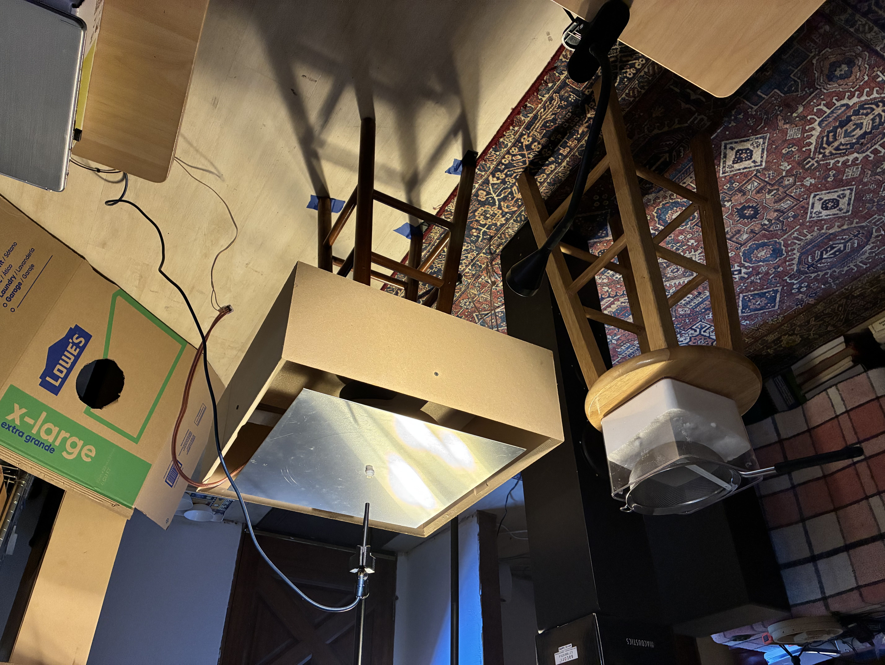
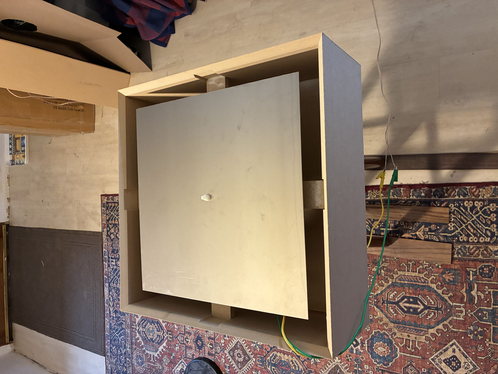

# Chladni Plate

| Final Experimental Setup | Sample Data Point: 287.80 Hz |
|:---:|:---:|
|  |  |

## Overview
I saw a video on [Youtube](https://www.youtube.com/watch?v=wvJAgrUBF4w) showing really interesting looking patterns created by pouring sand onto a plate, then vibrating it at particular frequencies. I decided to try and recreate it myself. My dad’s an audio engineer, so I had the necessary equipment to carry this out. I first simulated what I expected to happen in python, accounting for my own experimental parameters. Then I designed a physical setup in solidworks, and created it on a CNC machine via a toolpath software, to try and recreate the predicted patterns physically. My data wasn’t as visually distinct as I had hoped initially, so I redesigned some parts of the setup, carried out the data acquisition process more thoroughly and carefully, and improved the simulations a bit. This yielded much more visually distinct 2D standing wave patterns on the plate.

## Quick Notes

This README is a summary of the project, but to see more technical details, I reccomend reading the associated documents in the notes folder in this order:
1. [Mathematical Setup](notes/mathematical_setup.md)
2. [Numerical Setup](notes/numerical_setup.md)
3. [Physical Frequency Scaling](notes/frequency_scaling.md)
4. [Experimental Setup and Procedure](notes/experimental_setup.md)
5. [Experimental Results](notes/experimental_results.md)
6. [Discussion and Future Improvements](notes/Discussion.md)

The media folder contains all of the images and videos involved in the experiment, the plots folder contains the simulated plots, one where I account for our center driven force in forced_response, and one where I don't. The simulation folder is where I made the code for the simulations. The forced_response file created the simulations I used for the experiment, and the other files will be explained in the more detailed sections. I carried out most of this project myself, but I had some assistance in designing and creating the components of the physical setup.

## Mathematical Model
The mathematical model I used was the one presented in this 2018 [research paper](https://uwaterloo.ca/computational-mathematics/sites/default/files/uploads/documents/linqi_shao_report_pdf_1.pdf) by Linqi Shao. In chapter 2 they give the mathematical description of a thin plate with free edges and a fixed center as a thin, stretched membrane, described by the equation $\frac{\partial^2 u}{\partial t^2}=c^2\nabla^2u$. However, they found that the nodal lines formed by sand when vibrating the plate didn’t match up with what this equation predicted. So in chapter 3 they changed the model to a thin elastic plate with free edges and a fixed center described by the equation $\frac{\partial^2 u}{\partial t^2}+D^2\nabla^4u=Q(x,y,t)$. Now the model contains the biharmonic operator which accounts for the bending of the plate, a bending stiffness term, and a force term $Q$.
This model yielded results closer to what’s expected, but they had issues dealing with the associated boundary conditions. So I used a [research paper](https://link.springer.com/article/10.1007/s42452-020-04062-6) published in 2021 by S. J. D. D’Alessio to better understand how to deal with these boundary conditions, especially as it pertains to trying to simulate the motion of the plate. They were also looking at a thin elastic plate with free edges and a fixed center, and similarly used the elastic model.

[Link to the model details](notes/mathematical_setup.md)

## Simulations
I wanted to generate some simulations to give me certain frequencies to check with my physical setup, specifically where the plate is resonant, since this is likely to yield the most distinct patterns in standing waves. I also just wanted something to compare to for some other frequencies I was interested in testing. The mathematical setup behind the simulations is complicated, but basically D’Alessio used a method called finite volume difference, and I closely followed their approach. It involves treating the plate as a set of evenly spaced, discrete points, where each point has some displacement $u$ and acceleration $u_tt$. Each time the time $t$ is evolved, always at a constant interval $\Delta t$, there’s a predicted displacement at every point, and we use neighboring displacements to predict the acceleration at every point. This process repeats for as long as we want it to. However, since the equation has a fourth order spatial derivative, D’Alessio implemented a method of solving it in two steps. First you calculate a dummy variable $\text{1)}\quad w=\nabla^2u$, then you use it to solve the equation $\text{2)}\quad \frac{\partial^2u}{\partial t^2}+\nabla^2w=Q(x,y,t)$. The way that they dealt with the challenging boundary conditions is using this two step method, as well as using ghost points outside of the plate to maintain the proper boundary conditions.

[Link to the advanced simulation details](notes/numerical_setup.md)

## Initial Setup

**Figure 1: Initial Experimental Setup**

Our first setup consisted of a [lightweight driver](media/setup/initial_setup_misc/Driver1.jpg), a [plastic cap](media/setup/initial_setup_misc/Plastic%20Cap.jpg) surrounding its [nylon screw and cap](media/setup/initial_setup_misc/Cap%20and%20Screw.jpg), with a nylon screw affixed to the cap as well as to the thin aluminum plate via bolts and washers. I designed a wooden enclosure to hold the driver in the air to prevent vibrations causing it to wobble. This was also to collect the sugar that would fall off the plate during the experiment, which we used instead of sand. We swept through the 50-700 Hz region in increments of 5-10 Hz, using a function generator and amplifier hooked up to the driver. The force on the plate is applied through the rod through its exact center, which is also where the plate is fixed. We had sugar evenly spread out along the plate such that we could notice whenever a distinct pattern emerged, and when it did, we made smaller incremental jumps until we found which particular local frequency gave the best response. Then we cleared off the plate and poured on new sugar, and took a video of the sugar forming into nodal lines. We later compared these results to what the simulation predicted at these frequencies. The patterns we found generally had the correct shape, but the sugar wasn’t moving nearly as well as we had liked, so the videos and images looked messy. We also weren’t convinced that these were all resonances.

## Improved Setup
In the initial setup, there was noticeable compression on the driver when we placed the plate on top of it, and due to the weakness of the driver when we tried turning up the input voltage, the wires started overheating. so we used a stronger, stiffer driver that wouldn’t get compressed nearly as much or overheat at all. We used the same nylon screw and attachment method, but we used a strong [rubber ring](media/setup/final_setup_misc/Ring.jpg) with a [fitted cap](media/setup/final_setup_misc/Ring%20cap%20bottom.jpg) I designed in solidworks instead of the weak plastic cap, to keep the rod solidly in place. We also took more care in making sure that everything was exactly level when assembling the experiment. We wanted a more objective way to find where the plate is resonant, so we switched to using digital software and a microphone placed a few inches above the center of the plate. Then we performed a quick sweep through the 50-100 Hz frequency range which is continuous rather than in discrete intervals, and took note of at which frequencies we got the highest SPdBV response. We began our new investigation by performing the same procedure as before, but looking at these particular frequencies. Then we also took data on other frequencies of interest: simulation predicted resonances, we tested our old frequencies on this new setup, tested for a particular harmonic series, and looked at a few extra intriguing frequencies.

[Link to further explanation of setups and results](notes/experimental_setup.md)

## Data Analysis

Using our final setup, we first investigated the [frequencies](media/1_microphone_frequencies/Photos) that our microphone sweep yielded to have the highest SPdBV.

| Experimental Result: 287.80 Hz | Numerical Simulation: 287.80 Hz |
|:---:|:---:|
|  |  |

The 287.80 Hz pattern is the most accurate one from the data set when compared to the simulation, and is visually distinct. The only discrepancies from our data vs the simulation are a small circle of sugar which collected around the center, as well as our outermost corner lines being slightly rounder than expected.

| Experimental Result: 447.18 Hz | Numerical Simulation: 447.18 Hz |
|:---:|:---:|
|  |  |

The 447.18 Hz result is very distinct as well, and has good agreement with the simulation overall besides an issue at the corners. The center circle and its surrounding nodal line looks good, but the corners should form their own, square-ish pattern rather than connecting to the outer nodal line. From both of these images, it seems like with how similar the plots are it’s possible that we either needed to fine tune the exact frequency we used slightly, or our simulations are slightly wrong. Since these frequencies are the ones that the microphone predicted to be the right ones to use, we didn’t fine tune this data set. We did use that strategy though for certain frequencies throughout parts of the other datasets in trying to get perfect agreement, but we could never quite reproduce the simulation. This makes us think that our simulations might need to be coded differently.

| Experimental Result: 579.89 Hz | Numerical Simulation: 579.89 Hz |
|:---:|:---:|
|  |  |

Our 579.89 Hz result was interesting because it almost looks like an inverse of what’s predicted, particularly the center pattern. There’s still no central, rounded square though. I bet if we swept through the nearby frequencies we could find something more similar to this pattern. Overall, we were impressed with how well the microphone predicted where the most visually distinct patterns were. However, when trying to match up with what our simulations predict, the only proper way to do so must be getting in the right ballpark with the microphone, then making fine adjustments till we find the exact pattern.

| Experimental Result: 684.41 Hz | Numerical Simulation: 684.41 Hz |
|:---:|:---:|
|  |  |

Our 684.41 Hz pattern, as well as our 724.19 Hz pattern had the same general pattern as predicted by the simulations, but the results were pretty messy. Particularly in this 684.41 Hz case, you can see that the exact center shape is hard to make out, though the outer lines look fairly accurate. This is another case where if we fine tuned the frequency we’d likely get a better result, but this time not just in matching up with the simulation, but also in visual clarity and pattern formation. The higher frequencies generally caused us the most issues overall, among most of the datasets.

The expanded data analysis is in the same [experimental_results](notes/experimental_setup.md) link as above.

## Error and Limitations
In making our simulations we treated the center driven force as a point force. However, the radius of the rod which connected the ring to the plate was not completely negligible. Its physical attachment to the plate was also likely to add additional bending restrictions that wouldn’t exist otherwise. The plate itself wasn’t perfectly flat either, it had a slight parabolic shape to it that wasn’t completely consistent either. In one direction it might be slightly more parabolic than in another. We still were able to get the plate leveled close to the center, but closer to the edges it wasn’t feasible. In terms of data collection, we stuck with the approach of pouring on a fresh batch of sugar whenever we wanted to take data. This is because the patterns would get intermixed and not look very good if we kept the same sugar on the plate and just swept through various frequencies. However, this also meant that it was harder to identify the exact frequency that we should use, and could be a likely cause for what made certain results either messy or dissimilar to what the simulation predicted. The biggest improvement we’d make in trying to do this experiment again is some way to measure the vibration of the plate exactly, that way we could easily sweep through the frequency range and find where the most distinct patterns would be.

[Link to in depth error discussion and possible improvements/further investigations](notes/Discussion.md)